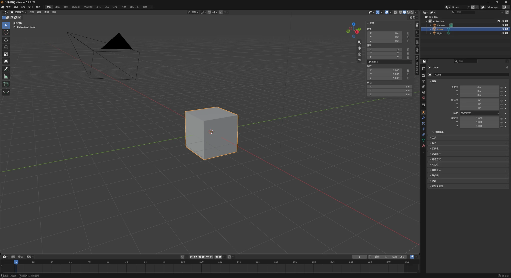
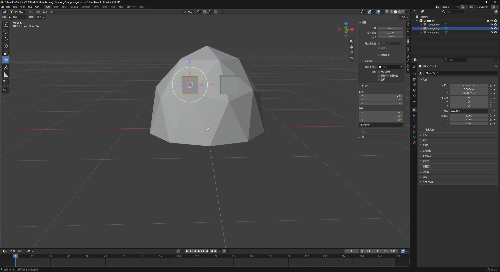

# BLENDER-NOTES.md — learning the window

Assignment 3 asks for a short session spent just looking at Blender before any
prompting, and for six parts of the interface named and described **in my own
words**, with one screenshot of my own session.

- **Blender:** 5.2.2 LTS (build 2026-09-15), Windows 11, Chinese interface
- **Session:** 2026-10-14, default startup file, Cube selected
- **Screenshot:** `design/blender/learn-the-window.png` — my own session, not a
  manual figure

> **Note on authorship.** The descriptions below are mine. Claude set out the
> headings and the screenshot and asked me what I had seen; it did not write
> the descriptions, because the assignment asks for my words and because a
> description I did not write would be worth nothing when a TA asks me to point
> at something.

---

## 1. 3D viewport — 3D 视口

> 中间是视图。

The large area in the middle. The cube, the camera (the wireframe pyramid at
the upper left) and the light all live in it, and it is what I orbit, pan and
zoom around.

## 2. Sidebar (N panel) — 侧栏

> 按了 n 之后属性之类的，条目、工具、视图…… 都在右边。

It opens over the right edge of the viewport when I press **N**, with tabs
stacked vertically down its edge. On the 变换 (Transform) tab it shows the
selected object's 位置 (location), 旋转 (rotation), 缩放 (scale) and 尺寸
(dimensions).

What that panel shows for the default cube is the reason this session happened
before the brief: **尺寸 X/Y/Z all read `2 m`, with 缩放 all `1.000`.** So one
Blender unit is one metre here, the cube is two metres across, and the sizes I
wrote into `CHANGE-BRIEF.md` are measured against something I have actually
seen rather than guessed.

*(To check when I next open Blender: the fourth vertical tab on that sidebar.
I wrote "动画" from memory, but in the screenshot the tabs read 条目 / 工具 /
视图 and then **MCP for Blender**, which is the add-on's own tab. I would
rather correct this than leave a description that does not match my own
screenshot.)*

---

## 3. Toolbar — 工具栏

The vertical strip of icons down the **left** edge of the viewport — box 1 in
`design/blender/interface-parts-labelled.png`. Top to bottom: select, the 3D
cursor, move, rotate, scale, transform, annotate, measure, add-cube.

> 切换工具栏的话我鼠标的功能会改变。
>
> *(Switching the toolbar changes what my mouse does.)*

That is the whole point of it, and it is the same idea as the mode selector in
§6 — see the note at the end of this section.

## 4. Outliner — 大纲视图

The panel at the **top right** — box 2. It lists the scene as a tree: 场景集合
→ Collection → Camera, Cube, Light, with an eye icon and a camera icon on each
row.

> 主要告诉你「场景里到底有什么、它们之间是什么关系」。
>
> *(Mainly tells you what is actually in the scene and how the things in it
> relate to each other.)*

The relationship half is what the viewport cannot give you. Looking at the
slime I see one green shape; the Outliner shows it is three objects —
`Slime_Body`, `Slime_Eye_1`, `Slime_Eye_2` — which is why the hand edit was
possible at all.

## 5. Properties editor — 属性编辑器

The tall panel at the **bottom right** — box 3, with the column of small tab
icons down its left side. In my screenshot it is on the object tab, showing
变换 (位置 / 旋转 / 缩放) and then 关系, 集合, 实例化, 可见性 and the rest.

> 属性编辑器和 N 侧栏确实都有位置、旋转、缩放，但定位不一样。N 侧栏是
> 「当前这个对象在视口里的快速参数面板」。
>
> *(The Properties editor and the N sidebar both have location, rotation and
> scale, but they are positioned differently. The N sidebar is the quick
> parameter panel for whichever object is current in the viewport.)*

## 6. Mode selector — 模式选择器

The dropdown at the **top left of the viewport header** — box 4, reading
**物体模式** (Object Mode).

> 模式选择器里我切换到了雕刻模式，鼠标的功能也变了。
>
> *(In the mode selector I switched to Sculpt Mode, and the mouse's function
> changed too.)*

### The thing the toolbar and the mode selector have in common

I wrote the same sentence twice without meaning to — *"鼠标的功能会改变"* for
the toolbar in §3 and *"鼠标的功能也变了"* for the mode selector in §6. They
really are the same idea at two scales. The toolbar changes what one drag of
the mouse does inside the mode I am already in; the mode selector changes what
the whole application is for, and Sculpt Mode is the clearest case of that —
the same left-drag that moved an object a moment ago now pushes the mesh
around.

---

## What I learned going through all six

> 都过完了，学会了如何切换选择的物体部分，如何改变视图，如何调整模型。
>
> *(Went through them all. Learned how to switch which part of a model is
> selected, how to change the view, and how to adjust a model.)*

Those three are the operations the rest of this assignment runs on: selecting
a part is how I reached a single eye cube rather than the whole slime,
changing the view is how I got behind and under each asset for the human check
in `TEST-REPORT.md` section A6, and adjusting a model is the hand edit below.

---

## The hand edit

I made two. The first one I undid, and that is worth recording as much as the
one that stayed.

### First try — the spike trap, moved and moved back

> 打开了尖刺文件，改了一下 xy 轴,学会了如何调整模型位置。
>
> *(Opened the spike file, changed the x and y axes, learned how to move a
> model.)*

Then I put it back where it was, because I was only trying it out. When Claude
compared `spike_trap.blend` against what the build script produces, every
coordinate matched and the file's timestamp had not moved: the edit left no
trace at all. The assignment says a TA may ask me to show which part I edited
by hand, and an edit I reverted is not something I can show. Worth knowing
before the deadline rather than after it.

### The one that stayed — the slime's eyes

In the Godot render the eyes looked too small and sat too high to read at
game size, next to a player who is 1.75 m. So I selected each eye cube in the
viewport and scaled it with **S**, then nudged it down.

|  | before | after |
|---|---|---|
| `Slime_Eye_1` | scale 1.000, z 0.6400 | **scale 1.526**, z 0.6129 |
| `Slime_Eye_2` | scale 1.000, z 0.6400 | **scale 1.570**, z 0.6141 |

My own session, photographed from the screen I was working on — not a
reconstruction. One frame carries four things: the title bar names the file
(`design/blender/slime.blend`), the Outliner shows `Slime_Eye_1` selected
apart from the body and the other eye, the Properties editor reads its
position as **X −0.19831, Y −0.50546, Z 0.61295 m**, and its scale reads
**1.000** on all three axes because the scale was applied into the mesh
afterwards. Those position numbers are the ones the measurement above
reports, to five decimal places.

The two are not identical — 1.526 against 1.570 — because I sized them by eye
rather than by typing a number. I am leaving the asymmetry: it is what a hand
edit looks like, and at game size it reads as character rather than as error.

Claude applied the scale into the mesh afterwards (`Ctrl+A` → Scale, which the
build scripts do for every object they create) so the exported `.glb` carries
no node scale, and re-ran the check: the bounding box is still exactly
**1.375 × 1.000 × 1.375 m** with its origin on the floor, so the edit changed
the look without breaking anything `CHANGE-BRIEF.md` promised.

### What it taught me about the interface

> 学会了如何切换选择的物体部分，如何调整模型。
>
> *(Learned how to switch which part of a model is selected, and how to adjust
> a model.)*

Selecting *a part* rather than the whole thing is the half that mattered here.
The slime is three objects — a body and two eye cubes — and the edit only
worked because I could click one eye on its own instead of scaling the
creature. **G** moves, **S** scales, and the sidebar's 位置 and 缩放 numbers
change as you drag, which is how I could tell afterwards that one eye had
ended up at 1.526 and the other at 1.570.
